<div align="center">

# ⚽ Maydonuz

### Toshkentdagi futbol maydonlarini qidirish, band qilish va boshqarish platformasi

[](https://react.dev/)
[](https://www.typescriptlang.org/)
[](https://vitejs.dev/)
[](https://tailwindcss.com/)
[](https://leafletjs.com/)
[](https://github.com/Farhodoff/maydonuz.uz)

</div>

---

## 📌 Loyiha haqida

**Maydonuz** — futbol havaskorlari hamda stadion egalari uchun mo‘ljallangan zamonaviy, tezkor va qulay veb-platforma. 

Platforma orqali Toshkent shahri va viloyatidagi mini-futbol, futzal, zamonaviy yopiq va sun’iy qoplamali maydonlarni real vaqt rejimida qidirish, narxlarni solishtirish, bo‘sh soatlarni tekshirish va ortiqcha qo‘ng‘iroqlarsiz 1 daqiqada onlayn band qilish mumkin.

---

## ✨ Asosiy imkoniyatlar

### 1. ⚽ Maydonlar katalogi va Interaktiv Xarita
* **Qidiruv va aqlli filtrlar:** Maydon nomi, tuman (Chilonzor, Yunusobod, Mirobod va b.), maydon turi (sun'iy maysa, tabiiy chim, yopiq arena) va narx bo‘yicha tezkor saralash.
* **Tezkor chip-filtrlar:** 1 marta bosishda `⭐ 4.5+ Reyting`, `💰 Arzonroq`, `🌱 Sun'iy` kabi maydonlarni ajratib olish.
* **Leaflet & OpenStreetMap:** Maxsus xarita pinlari, interaktiv narx va qulaylik ko‘rsatkichlari, Toshkent markaziga qaytish kompas tugmasi.
* **Ro‘yxat va Xarita ko‘rinishlari:** Istalgan vaqtda qulay ko‘rinishga o‘tish (Map / List view toggle).

### 2. 🔒 Auth Gate (Ro‘yxatdan o‘tish himoyasi)
* Mehmon foydalanuvchilar maydonlar ro‘yxati, suratlar, xaritadagi joylashuv va narxlarni erkin ko‘ra oladilar.
* Maydon egasining telefon raqamini ko‘rish yoki maydonni band qilish uchun avtomatik ro‘yxatdan o‘tish taklif etiladi.
* Tezkor SMS/kod simulyatsiyasi bilan tizimga kirish va ro‘yxatdan o‘tish.

### 3. ⚡ "Qanday ishlaydi?" (Interaktiv Onboarding)
Yangi tashrif buyuruvchilar uchun 3 ta bosqichda to‘liq yo‘riqnoma:
1. **Maydonni tanlang:** Tumanlar bo‘yicha interaktiv jonli natija ko‘rgazmasi.
2. **Vaqtni belgilang:** Real vaqt rejimida bo‘sh soatlar va band qilingan vaqtlarning interaktiv jadvali.
3. **Futbol o‘ynang (Match Pass):** Raqamli o‘yin chiptasi va uni Telegram orqali do‘stlarga ulashish imkoniyati.

### 4. 🏟️ "Maydon egalari" (Biznes & Daromad Kalkulyatori)
Stadion egalari va menejerlari uchun maxsus biznes bo‘limi:
* Bo‘sh vaqtlarni to‘ldirish va mijozlar oqimini 40% gacha oshirish imkoniyati.
* **Interaktiv Daromad Kalkulyatori:** Soatlik narx va kunlik o‘rtacha bandlik soatlarini kiritib, oylik kutilayotgan umumiy daromad va qo‘shimcha foydani hisoblash.
* Yangi maydon qo‘shish va buyurtmalarni nazorat qilish paneli (Owner Dashboard).

### 5. 🌐 Zero-Friction Ko‘p tillilik (UZ | RU | EN)
* **Direct Segmented Switcher:** Menyu ichiga kirib o‘tirmasdan, Navbar’dagi `[ 🇺🇿 O‘Z | 🇷🇺 РУ | 🇬🇧 EN ]` orqali 1 marta bosishda butun platforma tilini almashtirish.
* **Mobil versiyada ham doimiy mavjud:** Mobil telefonlarda ham gamburger-menyuni ochish shart emas.
* O‘zbekcha, Ruscha va Inglizcha to‘liq va professional mahalliylashtirish.

### 6. 💳 Bron qilish va To‘lovlar (Booking & Invoicing)
* Bo‘sh soatlarni onlayn tanlash.
* To‘lov usullari: **CLICK**, **Payme** va joyida **Naqd pul**.
* Muvaffaqiyatli to‘lovdan so‘ng raqamli chek (kvitansiya) va kvitansiya ID raqami.
* Shaxsiy kabinetda "Mening bronlarim" tarixi va holatlari (to‘langan, to‘lanmagan, bekor qilingan).

---

## 🛠️ Texnologiyalar steki

| Qatlam | Texnologiya | Vazifasi |
|---|---|---|
| **Frontend Framework** | React 18 | Komponentlar va reaktiv interfeys |
| **Til** | TypeScript 5 | Tip xavfsizligi va ishonchli arxitektura |
| **Yig‘uvchi (Bundler)** | Vite 5 | Tezkor Hot Module Replacement (HMR) va build |
| **CSS & Styling** | Tailwind CSS 3 | Moslashuvchan va zamonaviy UI dizayn |
| **Xarita** | Leaflet + React-Leaflet | OpenStreetMap asosidagi interaktiv xarita |
| **Ikonkalar** | Lucide React | Yengil va toza SVG ikonkalar |
| **Holat boshqaruvi** | React Context API | App, Auth, Booking, Language, Toast contextlari |
| **Kod sifati** | ESLint + TypeScript ESLint | Toza kod standartlari |

---

## 🏛️ Tizim Arxitekturasi va Ma'lumotlar Oqimi (System Architecture)

**Maydonuz** platformasi modulli komponentlar, markazlashgan Context holat boshqaruvi va yuqori tezlikdagi klient-tomon reaktiv qidiruv dvigateli asosida qurilgan:

```mermaid
flowchart TD
    %% Styling and Theme Classes
    classDef ui fill:#0F172A,stroke:#38BDF8,stroke-width:2px,color:#F8FAFC
    classDef view fill:#1E293B,stroke:#818CF8,stroke-width:2px,color:#F8FAFC
    classDef context fill:#312E81,stroke:#C084FC,stroke-width:2px,color:#F8FAFC
    classDef business fill:#064E3B,stroke:#34D399,stroke-width:2px,color:#F8FAFC
    classDef storage fill:#451A03,stroke:#FBBF24,stroke-width:2px,color:#F8FAFC

    subgraph ClientUI["📱 Foydalanuvchi Interfeysi (UI & Navigation)"]
        Header["🧭 Navbar & i18n Switcher<br/>(UZ | RU | EN til segmentlari)"]:::ui
        SearchBox["🔍 Aqlli Filtrlar & Qidiruv<br/>(Tumanlar, Narx, Chip-filtrlar)"]:::ui
        ViewSwitch["🔀 Ko'rinish Almashtirgich<br/>(Xarita / Ro'yxat rejimi)"]:::ui
        MobileNav["📲 Mobile Bottom Navigation<br/>(Tezkor mobil boshqaruv)"]:::ui
    end

    subgraph ViewsLayer["🖥️ Vizual Taqdimot Qatlami (Views & Modals)"]
        ListView["📋 Ro'yxat Ko'rinishi (ListView)<br/>(FieldCard, Skeletons, Reyting)"]:::view
        MapView["🗺️ Interaktiv Xarita (MapView)<br/>(Leaflet + OpenStreetMap pinlari)"]:::view
        Modals["🪟 Modallar Tizimi<br/>(Auth, Maydon Tafsiloti, Bron Tarixi)"]:::view
        OwnerDash["🏟️ Stadion Egasi Paneli<br/>(Daromad Kalkulyatori & Boshqaruv)"]:::view
    end

    subgraph ContextTier["⚙️ Holat Boshqaruvi (React Context Architecture)"]
        LangCtx["🌐 LanguageContext<br/>(UZ / RU / EN lug'atlar & tarjima)"]:::context
        AppCtx["🎯 AppContext<br/>(Filtrlash, Saralash, Aktiv Maydon)"]:::context
        AuthCtx["🔐 AuthContext<br/>(Auth Gate, SMS Verification)"]:::context
        BookCtx["💳 BookingContext<br/>(Bo'sh vaqtlar, Click/Payme to'lov)"]:::context
        ToastCtx["🔔 ToastContext<br/>(Jonli xabarnomalar navbati)"]:::context
    end

    subgraph BusinessEngine["⚡ Biznes Mantiq & Dvigatellar (Logic Engine)"]
        FilterEngine["⚡ Instant Filter & Search<br/>(Debounced live filtering)"]:::business
        SlotScheduler["🕒 Real-Time Slot Scheduler<br/>(Band va bo'sh soatlar taqvimi)"]:::business
        MatchPassGen["🎟️ Match Pass Generator<br/>(Telegram kvitansiya & ID)"]:::business
        RevCalc["💰 Revenue Calculator<br/>(Stadion oylik rentabellik hisobi)"]:::business
    end

    subgraph DataStorage["🗄️ Ma'lumotlar Baza & Saqlash Qatlami"]
        MockDB[("⚽ Toshkent Maydonlar Bazasi<br/>(mockData.ts - 50+ maydonlar)")]:::storage
        LocalStore[("💾 Brauzer LocalStorage<br/>(Bronlar tarixi, Til, Foydalanuvchi)")]:::storage
    end

    %% UI to Views
    Header --> LangCtx
    SearchBox --> AppCtx
    ViewSwitch --> ListView
    ViewSwitch --> MapView
    MobileNav --> Modals

    %% Views to Contexts
    ListView <--> AppCtx
    MapView <--> AppCtx
    Modals <--> AuthCtx
    Modals <--> BookCtx
    OwnerDash --> RevCalc

    %% Contexts to Engines
    AppCtx --> FilterEngine
    FilterEngine --> MockDB
    BookCtx --> SlotScheduler
    BookCtx --> MatchPassGen

    %% Storage Integration
    BookCtx <--> LocalStore
    AuthCtx <--> LocalStore
    LangCtx <--> LocalStore
    ToastCtx -.-> ClientUI
```



### 🔄 Foydalanuvchi va Bron Qilish Oqimi (User & Booking Flow)

1. **Qidiruv va Saralash:** Foydalanuvchi tuman (Chilonzor, Yunusobod...) yoki chip-filtrlar (`⭐ 4.5+`, `💰 Arzonroq`) orqali filtrlaydi $\rightarrow$ `AppContext` filtr parametrlarini oladi $\rightarrow$ `FilterEngine` real vaqtda bazani saralab, bir vaqtning o'zida `ListView` hamda `Leaflet MapView` xaritasidagi pinlarni yangilaydi.
2. **Auth Gate Himoyasi:** Foydalanuvchi maydon tafsilotlari yoki bron qilish tugmasini bosganda, `AuthContext` sessiyani tekshiradi. Agar mehmon bo'lsa, xavfsiz `AuthModal` ochiladi.
3. **Vaqt Tanlash va To'lov:** `BookingContext` tanlangan sana bo'yicha bo'sh vaqt slotlarini taqdim etadi $\rightarrow$ CLICK, Payme yoki Naqd pul usuli tanlanadi $\rightarrow$ tranzaksiya tasdiqlangach, unikal chipta kodi bilan raqamli **Match Pass** yaratiladi va `LocalStorage`ga saqlanadi.
4. **Ko'p Tillilik:** Navbar'dagi segmented tugma orqali til o'zgarganda butun interfeys, modallar va xabar bildirishnomalari qayta yuklanmasdan bir zumda o'zgaradi.

---

## 📂 Loyiha kataloglar strukturasi

```text
maydonuz.uz/
├── public/                  # Statik fayllar (favicon, rasmlar)
├── src/
│   ├── components/
│   │   ├── common/          # Navbar, Footer, HowItWorks, MobileBottomNav, ViewToggle
│   │   ├── list/            # FieldCard, ListView, FieldCardSkeleton
│   │   ├── map/             # MapView (Leaflet interaktiv xaritasi)
│   │   ├── modals/          # AuthModal, FieldDetailsModal, MyBookingsModal, OwnerDashboardModal
│   │   └── search/          # SearchBar, Filters
│   ├── contexts/            # AppContext, AuthContext, BookingContext, LanguageContext, ToastContext
│   ├── data/                # mockFields.ts (Toshkent maydonlari ma'lumotlar bazasi)
│   ├── pages/               # HomePage
│   ├── types/               # TypeScript tip va interfeyslari
│   ├── utils/               # Yordamchi funksiyalar (formatters, debounce)
│   ├── App.tsx              # Asosiy app kirish nuqtasi
│   ├── index.css            # Tailwind va global stillar
│   └── main.tsx             # React DOM render
├── index.html
├── package.json
├── tailwind.config.js
├── tsconfig.json
└── vite.config.ts
```

---

## 🚀 Loyihani lokal ishga tushirish

### Talablar
* Node.js `>= 18.0.0`
* npm yoki yarn

### O‘rnatish va ishga tushirish

1. **Repozitoriyani klonlash:**
   ```bash
   git clone https://github.com/Farhodoff/maydonuz.uz.git
   cd maydonuz.uz
   ```

2. **Kutubxonalarni o‘rnatish:**
   ```bash
   npm install
   ```

3. **Ishchi serverni ishga tushirish (Dev server):**
   ```bash
   npm run dev
   ```
   Server ishga tushgach, brauzerda `http://localhost:5173` (yoki ko‘rsatilgan port) manzilini oching.

4. **Kod sifatini tekshirish (Linting):**
   ```bash
   npm run lint
   ```

5. **Production uchun yig‘ish (Build):**
   ```bash
   npm run build
   ```

---

## 📄 Litsenziya

Ushbu loyiha [MIT](LICENSE) litsenziyasi asosida tarqatiladi.

Muallif: **[Farhodoff](https://github.com/Farhodoff)**
